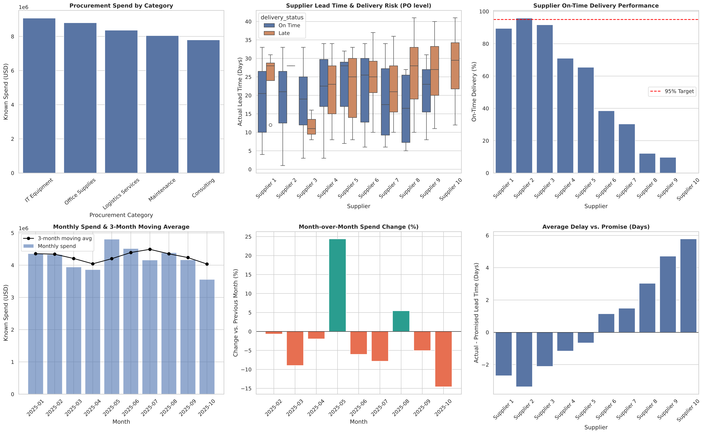

# Procurement Intelligence Analysis

End-to-end analytics project on **synthetic** purchasing data: relational modeling, SQL window functions, data-quality checks, transformation and BI-style visualization.



## Business problem
A procurement team needs to answer three questions:
1. Where is the money going, and how concentrated is spend by supplier?
2. Which suppliers deliver on time, and which put the supply chain at risk?
3. How is spend trending month over month, and how reliable is the underlying data?

## What this project demonstrates
| Skill | Where |
|---|---|
| Relational modeling (PKs, FKs, constraints) | SQLite schema: `suppliers`, `categories`, `purchase_orders`, `po_lines` |
| CTEs | Spend, delivery and monthly queries |
| Window functions | `DENSE_RANK`, running `SUM() OVER`, `LAG`, 3-month moving `AVG` |
| Data quality | Missing-price detection; unknown prices are kept as `NULL`, never imputed as zero |
| Transformation | PO-level vs. line-level datasets (avoids double-counting POs) |
| Visualization | 6-panel dashboard + Pareto charts per category (seaborn / matplotlib) |

## Key findings (seed 42)
- **Only 1 of 10 suppliers meets the 95% on-time target** (Supplier 2, 95.8%). Suppliers 8, 9 and 10 are below 15%, and Supplier 10 averages almost 6 days late.
- **Spend is fairly diversified.** In Consulting, the top supplier holds ~19% of spend and it takes 7 suppliers to pass the 80% mark. No single-source dependency.
- **Spend is volatile at month level.** May jumped +24% vs. April; the last month (October) is partial because the data ends on day 300.
- **Data completeness is 95.07%** (29 of 588 lines without price). Spend figures are therefore a lower bound.

## Project structure
```
procurement_analysis.py
requirements.txt
output/
  procurement_intelligence_dashboard.png
  supplier_pareto_by_category.png
  supplier_spend_analytics.csv
  monthly_spend_trend.csv
  supplier_delivery_performance.csv
  data_quality_metrics.csv
```

## How to run
```bash
pip install -r requirements.txt
python procurement_analysis.py
```
Outputs are written to `output/`.

## Notes
- All data is randomly generated; supplier delivery behavior is simulated with a per-supplier bias so the analysis tells a realistic story.
- Possible next steps: price-variance analysis by SKU, supplier scorecard combining cost and delivery, forecasting monthly spend.
